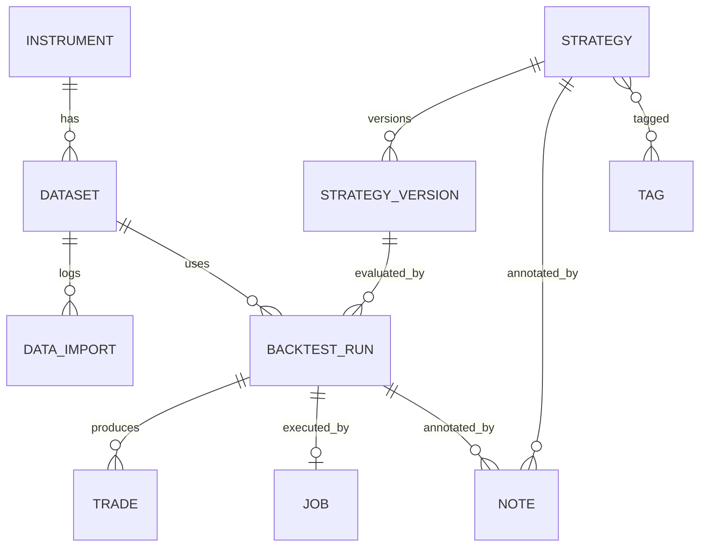

# Trading Strategy Research Platform — Architecture

**Version:** 1.0
**Date:** 2026-07-29
**Status:** Proposed — awaiting approval
**Scope:** Single-user, desktop-first, local-only research tool. Not a bot, not a broker, not live trading, not a SaaS.

---

## 0. Guiding Principles

These drive every decision below.

1. **The research loop is the product.** Everything exists to shorten the cycle:
   `idea → strategy → data → backtest → analyse → improve → new version → repeat`.
2. **Immutable history.** A backtest result must remain reproducible forever. Strategy versions and run configs are append-only; nothing that a result depends on is ever mutated.
3. **The engine is a library, not a web app.** `app/engine/` imports nothing from FastAPI, SQLAlchemy, or Pydantic. It takes plain dataframes and objects in, returns plain results out. This is the single most important rule for extensibility — optimisation, walk-forward, and Monte Carlo are all just *different ways of calling the same engine*.
4. **One direction of dependency.**
   `api → services → { repositories, engine, data } → domain`
   Nothing ever points back up. No service imports a router; no repository imports a service.
5. **Simple until proven otherwise.** SQLite, in-process jobs, no Docker, no message broker, no auth. Every future-proofing measure is an *interface*, not an implementation.
6. **Local-first storage.** All state lives under a single `data/` directory that can be zipped, backed up, or deleted.

### Key architectural decisions (rationale up front)

| Decision | Choice | Why |
|---|---|---|
| Strategy representation | Python source code implementing a `Strategy` base class, stored as text in DB, versioned | Maximum expressiveness with zero DSL to design or maintain. AI generation (future) emits Python naturally. A declarative rule-builder can be added later that *compiles down to the same interface* without touching the engine. |
| Sandboxing | None. Code executes in-process | Single user, own machine, own code. The trust boundary is you. Documented explicitly rather than half-solved. |
| Bar storage | Parquet files on disk, indexed by a SQLite catalog | SQLite is poor at multi-million-row time-series scans. Polars + Parquet reads a year of 1m bars in milliseconds with column pruning. SQLite keeps metadata, which is what it is good at. |
| Result storage | Trades + headline metrics in SQLite; equity curve and per-bar series in Parquet artifacts | Trades must be sortable/filterable/joinable (hundreds to thousands of rows). Per-bar series are large and only ever read whole for charting. |
| Job execution | In-process `ThreadPoolExecutor` behind a `JobRunner` interface, with a `jobs` table for state | A backtest is CPU-bound and takes seconds to minutes. Real queues (Celery/RQ) add operational weight for no benefit at N=1. The interface makes swapping trivial if optimisation sweeps ever need multiprocessing. |
| Pandas vs Polars | Polars for I/O, ingestion, resampling, validation. Pandas/NumPy inside the engine and indicators | Polars is dramatically faster for the bulk data path. The indicator/engine ecosystem and mental model is Pandas-native. Conversion happens at exactly one boundary. |
| API versioning | `/api/v1` from day one | Costs nothing now, avoids a painful rename later. |

---

## 1. Folder Structure

```
backtesting/
├── README.md
├── ARCHITECTURE.md                  # this document
├── CLAUDE.md                        # agent/dev conventions
├── .gitignore
├── .editorconfig
├── Makefile                         # dev entrypoints: make dev / test / lint / migrate
│
├── backend/
│   ├── pyproject.toml               # deps + ruff/mypy/pytest config (uv or poetry)
│   ├── alembic.ini
│   ├── alembic/
│   │   ├── env.py
│   │   └── versions/
│   ├── app/
│   │   ├── __init__.py
│   │   ├── main.py                  # FastAPI app factory, CORS, static frontend mount
│   │   │
│   │   ├── core/                    # cross-cutting, dependency-free-ish
│   │   │   ├── config.py            # Settings (pydantic-settings), reads .env
│   │   │   ├── paths.py             # resolves data root, market dir, artifacts dir
│   │   │   ├── logging.py           # structlog/std logging setup
│   │   │   ├── ids.py               # ULID/UUID7 generation
│   │   │   ├── time.py              # UTC helpers, timeframe parsing/arithmetic
│   │   │   ├── hashing.py           # deterministic config + code hashing
│   │   │   └── exceptions.py        # AppError hierarchy (DomainError, NotFound, Conflict…)
│   │   │
│   │   ├── db/
│   │   │   ├── base.py              # DeclarativeBase, naming convention, TimestampMixin
│   │   │   ├── session.py           # engine, SessionLocal, get_session context manager
│   │   │   └── pragmas.py           # WAL, foreign_keys=ON, busy_timeout
│   │   │
│   │   ├── models/                  # SQLAlchemy ORM — one file per aggregate
│   │   │   ├── instrument.py
│   │   │   ├── dataset.py           # dataset + data_import
│   │   │   ├── strategy.py          # strategy + strategy_version
│   │   │   ├── backtest.py          # backtest_run + trade
│   │   │   ├── job.py
│   │   │   ├── note.py
│   │   │   └── tag.py
│   │   │
│   │   ├── schemas/                 # Pydantic DTOs — request/response only
│   │   │   ├── common.py            # Page[T], ErrorResponse, IdResponse
│   │   │   ├── instrument.py
│   │   │   ├── dataset.py
│   │   │   ├── strategy.py
│   │   │   ├── backtest.py
│   │   │   ├── result.py
│   │   │   ├── job.py
│   │   │   └── indicator.py
│   │   │
│   │   ├── repositories/            # SQLAlchemy queries. No business rules.
│   │   │   ├── base.py              # generic get/list/create/delete helpers
│   │   │   ├── instrument_repo.py
│   │   │   ├── dataset_repo.py
│   │   │   ├── strategy_repo.py
│   │   │   ├── backtest_repo.py
│   │   │   ├── trade_repo.py
│   │   │   └── job_repo.py
│   │   │
│   │   ├── services/                # use cases. Orchestrate repos + engine + data.
│   │   │   ├── instrument_service.py
│   │   │   ├── dataset_service.py
│   │   │   ├── import_service.py
│   │   │   ├── strategy_service.py
│   │   │   ├── version_service.py
│   │   │   ├── backtest_service.py
│   │   │   ├── result_service.py
│   │   │   ├── comparison_service.py
│   │   │   ├── indicator_service.py
│   │   │   └── export_service.py
│   │   │
│   │   ├── api/
│   │   │   ├── deps.py              # Depends(): session, services, pagination
│   │   │   ├── errors.py            # exception_handlers → RFC7807-ish JSON
│   │   │   └── v1/
│   │   │       ├── router.py        # aggregates all routers under /api/v1
│   │   │       ├── system.py
│   │   │       ├── instruments.py
│   │   │       ├── datasets.py
│   │   │       ├── imports.py
│   │   │       ├── strategies.py
│   │   │       ├── strategy_versions.py
│   │   │       ├── backtests.py
│   │   │       ├── results.py
│   │   │       ├── indicators.py
│   │   │       ├── notes.py
│   │   │       └── jobs.py
│   │   │
│   │   ├── domain/                  # pure python. No I/O, no framework.
│   │   │   ├── enums.py             # Timeframe, OrderSide, OrderType, RunStatus…
│   │   │   ├── money.py             # rounding, tick/lot sizing
│   │   │   ├── timeframe.py
│   │   │   └── errors.py
│   │   │
│   │   ├── data/                    # market data layer
│   │   │   ├── store.py             # ParquetBarStore: read/write/append/coverage
│   │   │   ├── catalog.py           # reconcile store contents ↔ dataset rows
│   │   │   ├── loader.py            # load_bars(instrument, tf, start, end) -> DataFrame
│   │   │   ├── normalizer.py        # column mapping, tz→UTC, dtype coercion, sort
│   │   │   ├── validator.py         # gaps, duplicates, OHLC sanity, zero volume
│   │   │   ├── resampler.py         # 1m → 5m/15m/1h/1d
│   │   │   ├── schema.py            # canonical bar schema definition
│   │   │   └── readers/
│   │   │       ├── base.py          # BarReader protocol
│   │   │       └── csv_reader.py
│   │   │
│   │   ├── engine/                  # THE CORE. Framework-free, importable standalone.
│   │   │   ├── context.py           # BacktestContext: config, clock, data access
│   │   │   ├── runner.py            # BacktestRunner.run() — the bar loop
│   │   │   ├── events.py            # BarEvent, OrderEvent, FillEvent
│   │   │   ├── clock.py
│   │   │   ├── strategy/
│   │   │   │   ├── base.py          # Strategy ABC: on_start/on_bar/on_stop
│   │   │   │   ├── api.py           # what a strategy can call: buy/sell/close/log
│   │   │   │   ├── params.py        # ParamSpec + validation (feeds optimisation later)
│   │   │   │   ├── loader.py        # compile source text → Strategy subclass
│   │   │   │   └── registry.py      # built-in example strategies
│   │   │   ├── indicators/
│   │   │   │   ├── registry.py      # name → callable + metadata (for UI + AI)
│   │   │   │   ├── trend.py         # sma, ema, wma, macd, adx
│   │   │   │   ├── momentum.py      # rsi, stoch, roc, cci
│   │   │   │   ├── volatility.py    # atr, bbands, stddev, keltner
│   │   │   │   └── volume.py        # obv, vwap, mfi
│   │   │   ├── execution/
│   │   │   │   ├── simulator.py     # order matching against next bar
│   │   │   │   ├── order.py
│   │   │   │   ├── position.py
│   │   │   │   ├── portfolio.py     # cash, equity, exposure tracking
│   │   │   │   ├── sizing.py        # fixed / percent-equity / risk-per-trade
│   │   │   │   ├── costs.py         # commission models
│   │   │   │   └── slippage.py      # slippage models
│   │   │   ├── results/
│   │   │   │   ├── collector.py     # accumulates trades/equity during the run
│   │   │   │   ├── result.py        # BacktestResult dataclass
│   │   │   │   ├── trades.py        # fills → round-trip trades
│   │   │   │   └── metrics.py       # pure metric functions
│   │   │   └── errors.py            # StrategyCompileError, StrategyRuntimeError
│   │   │
│   │   ├── jobs/
│   │   │   ├── runner.py            # JobRunner protocol + ThreadPoolJobRunner
│   │   │   ├── registry.py          # job type → handler
│   │   │   ├── progress.py          # progress reporting callback
│   │   │   └── handlers/
│   │   │       ├── run_backtest.py
│   │   │       └── import_data.py
│   │   │
│   │   └── artifacts/
│   │       ├── writer.py            # equity curve / series → parquet under run id
│   │       └── reader.py
│   │
│   ├── tests/
│   │   ├── conftest.py
│   │   ├── unit/
│   │   │   ├── engine/              # heaviest coverage lives here
│   │   │   ├── data/
│   │   │   └── domain/
│   │   ├── integration/             # services + real SQLite temp db
│   │   ├── api/                     # TestClient route contracts
│   │   └── fixtures/                # tiny deterministic CSV bar sets
│   └── scripts/
│       ├── seed_examples.py
│       └── rebuild_catalog.py
│
├── frontend/
│   ├── package.json
│   ├── vite.config.ts
│   ├── tsconfig.json
│   ├── tailwind.config.ts
│   ├── components.json              # shadcn config
│   ├── index.html
│   └── src/
│       ├── main.tsx
│       ├── app/
│       │   ├── App.tsx
│       │   ├── router.tsx
│       │   ├── providers.tsx        # QueryClient, Theme, Toaster
│       │   └── layout/
│       │       ├── AppShell.tsx
│       │       ├── Sidebar.tsx
│       │       └── TopBar.tsx
│       ├── pages/                   # route-level, thin. Compose features.
│       │   ├── DashboardPage.tsx
│       │   ├── strategies/
│       │   │   ├── StrategyListPage.tsx
│       │   │   ├── StrategyDetailPage.tsx
│       │   │   ├── StrategyEditorPage.tsx
│       │   │   └── StrategyVersionsPage.tsx
│       │   ├── data/
│       │   │   ├── DataLibraryPage.tsx
│       │   │   ├── DatasetDetailPage.tsx
│       │   │   └── ImportDataPage.tsx
│       │   ├── backtests/
│       │   │   ├── NewBacktestPage.tsx
│       │   │   └── BacktestListPage.tsx
│       │   ├── results/
│       │   │   ├── ResultPage.tsx
│       │   │   └── CompareRunsPage.tsx
│       │   ├── NotesPage.tsx
│       │   ├── SettingsPage.tsx
│       │   └── NotFoundPage.tsx
│       ├── features/                # domain-grouped logic + components
│       │   ├── strategies/
│       │   │   ├── api.ts           # fetchers
│       │   │   ├── queries.ts       # useQuery/useMutation hooks
│       │   │   ├── types.ts
│       │   │   └── components/
│       │   │       ├── StrategyCard.tsx
│       │   │       ├── StrategyCodeEditor.tsx
│       │   │       ├── ParamSchemaEditor.tsx
│       │   │       ├── VersionTimeline.tsx
│       │   │       └── VersionDiffView.tsx
│       │   ├── data/
│       │   ├── backtests/
│       │   ├── results/
│       │   │   └── components/
│       │   │       ├── MetricTile.tsx
│       │   │       ├── MetricsGrid.tsx
│       │   │       ├── EquityCurveChart.tsx
│       │   │       ├── DrawdownChart.tsx
│       │   │       ├── PriceChartWithTrades.tsx
│       │   │       ├── TradesTable.tsx
│       │   │       └── MonthlyReturnsHeatmap.tsx
│       │   └── jobs/
│       │       ├── queries.ts
│       │       └── components/JobProgress.tsx
│       ├── components/
│       │   ├── ui/                  # shadcn primitives — generated, do not hand-edit
│       │   ├── charts/              # Lightweight Charts wrappers
│       │   │   ├── ChartContainer.tsx
│       │   │   ├── useLightweightChart.ts
│       │   │   └── seriesHelpers.ts
│       │   └── common/
│       │       ├── PageHeader.tsx
│       │       ├── EmptyState.tsx
│       │       ├── ErrorState.tsx
│       │       ├── DataTable.tsx
│       │       └── ConfirmDialog.tsx
│       ├── lib/
│       │   ├── apiClient.ts         # fetch wrapper, error normalisation
│       │   ├── queryKeys.ts         # centralised cache keys
│       │   ├── format.ts            # currency, percent, duration, date
│       │   ├── colors.ts            # semantic pnl colours, chart palette
│       │   └── utils.ts             # cn()
│       ├── hooks/
│       │   ├── useTheme.ts
│       │   └── usePolling.ts
│       ├── types/
│       │   └── api.ts               # generated from OpenAPI
│       └── styles/
│           └── globals.css
│
├── data/                            # ALL user state. gitignored. Backup = zip this.
│   ├── app.db
│   ├── market/
│   │   └── {instrument_symbol}/{timeframe}/{year}.parquet
│   ├── artifacts/
│   │   └── {run_id}/
│   │       ├── equity.parquet
│   │       ├── signals.parquet
│   │       └── run.log
│   ├── imports/                     # staged uploads awaiting processing
│   └── logs/
│
├── docs/
│   ├── strategy-authoring.md        # how to write a Strategy (the user manual)
│   ├── metrics.md                   # exact formula for every metric
│   ├── data-format.md               # canonical bar schema + import rules
│   └── decisions/                   # ADR-0001-*.md
│
└── scripts/
    ├── dev.sh                       # run backend + frontend together
    └── backup.sh
```

---

## 2. Module Breakdown

### 2.1 Backend layer contract

| Layer | Owns | May import | Must never |
|---|---|---|---|
| `api/v1` | HTTP shape, status codes, validation | `schemas`, `services`, `deps` | Touch ORM models or the engine directly |
| `services` | Use cases, transactions, orchestration | `repositories`, `engine`, `data`, `jobs`, `domain`, `models` | Import FastAPI or return Pydantic-only-shaped SQLAlchemy internals |
| `repositories` | SQL queries, persistence | `models`, `db` | Contain business rules or call other repositories' services |
| `engine` | Simulation, indicators, metrics | `domain`, pandas/numpy | Import anything from `app.api`, `app.services`, `app.models`, `app.db` |
| `data` | Bar storage, import, validation | `domain`, polars | Import `services` or ORM models |
| `domain` | Enums, value objects, invariants | stdlib only | Import anything else in the app |

This table is the enforcement rule. A lint rule (`ruff` banned-imports / `import-linter`) should encode it.

### 2.2 Engine module (the heart)

**`engine/strategy/base.py`** — the extension point everything hangs off.

A strategy subclass declares:
- `name`, `description`
- `params: list[ParamSpec]` — typed, with min/max/step/default. This single declaration powers: the UI parameter form, request validation, and (later) the optimiser's search space. Declaring it now is what makes parameter optimisation a non-refactor.
- `warmup_bars: int` — how many bars to skip before signals count.

Lifecycle hooks: `on_start(ctx)`, `on_bar(ctx, bar)`, `on_stop(ctx)`.

Strategy-facing API (deliberately tiny, so it can stay stable forever):
`ctx.buy() / sell() / close() / close_all()`, `ctx.position`, `ctx.portfolio.equity`, `ctx.data` (all bars up to and including current — no lookahead possible by construction), `ctx.indicator("rsi", 14)` (cached), `ctx.log()`, `ctx.params.x`.

**`engine/runner.py`** — the bar loop:
1. Load bars → validate → slice to date range
2. Compile strategy → instantiate with params
3. Pre-compute declared indicators (vectorised, once)
4. Iterate bars: `on_bar` → collect orders → `simulator` fills them against the **next** bar's open (configurable) → update portfolio → append equity point
5. `on_stop` → build trades from fills → compute metrics → return `BacktestResult`

**Lookahead prevention is structural, not a convention:** `ctx.data` is a bounded view; orders never fill on the signal bar by default.

**`engine/results/metrics.py`** — every metric is a pure function `(equity: Series, trades: DataFrame, config) -> float`. Testable in isolation, documented in `docs/metrics.md`.

Metrics set: total return, CAGR, max drawdown (+ duration), Sharpe, Sortino, Calmar, volatility, win rate, profit factor, expectancy, avg win/loss, largest win/loss, payoff ratio, max consecutive wins/losses, exposure %, total trades, avg trade duration, monthly returns table.

### 2.3 Data module

Canonical bar schema (enforced everywhere):
`ts` (int64 UTC epoch ms, ascending, unique) · `open` · `high` · `low` · `close` (float64) · `volume` (float64, nullable)

Import pipeline: `upload → stage → read → normalize → validate → write parquet → update catalog → report`.
The validator returns a *report* (gaps, duplicates removed, OHLC violations, rows rejected) that is persisted on `data_imports` and shown in the UI. Bad data silently corrupting a backtest is the failure mode this prevents.

### 2.4 Jobs module

`JobRunner` protocol: `submit(job_type, payload) -> job_id`, `get(job_id)`, `cancel(job_id)`.
Default implementation: `ThreadPoolJobRunner` (max_workers configurable, default 2). Job state persisted in `jobs` table so progress survives a page refresh and results are auditable. Frontend polls `GET /jobs/{id}` at ~1s while running.

### 2.5 Frontend module organisation

- **`pages/`** — routing + layout only. Reads params, renders feature components. Should stay under ~120 lines each.
- **`features/<domain>/`** — everything belonging to one domain: API fetchers, TanStack Query hooks, types, domain components.
- **`components/ui/`** — shadcn generated primitives. Never hand-edited; restyle via Tailwind theme tokens.
- **`components/charts/`** — the only place that imports `lightweight-charts`. Wrapped once so the library is swappable and the imperative API stays quarantined behind React-friendly props.

State strategy: **TanStack Query owns all server state.** Zustand (or plain context) only for genuinely client-side UI state (theme, sidebar collapse, comparison basket). No Redux. No global store of API data.

---

## 3. Database Design

SQLite with `WAL`, `foreign_keys=ON`, `busy_timeout=5000`. All timestamps stored as UTC epoch milliseconds (integers) for market data, and ISO-8601 UTC text for record audit fields. IDs are ULIDs (text) — sortable, no coordination, safe to expose.

### 3.1 ER overview



### 3.2 Tables

**`instruments`** — what you trade.
`id` PK · `symbol` (unique, e.g. `NIFTY`, `AAPL`) · `name` · `asset_class` (equity/futures/fx/crypto/index) · `exchange` · `currency` · `tick_size` · `lot_size` · `point_value` · `timezone` (session tz, e.g. `Asia/Kolkata`) · `created_at` · `updated_at`

**`datasets`** — one instrument at one timeframe from one source.
`id` PK · `instrument_id` FK · `timeframe` (`1m`,`5m`,`15m`,`1h`,`1d`…) · `source` (e.g. `csv:zerodha`) · `start_ts` · `end_ts` · `bar_count` · `storage_path` · `status` (ready/importing/error) · `quality_score` · `last_validated_at` · `created_at` · `updated_at`
Unique: `(instrument_id, timeframe, source)`

**`data_imports`** — audit trail of every ingestion.
`id` PK · `dataset_id` FK · `filename` · `file_hash` (sha256 — enables "already imported" detection) · `rows_read` · `rows_written` · `rows_rejected` · `duplicates_removed` · `gaps_detected` · `report_json` · `status` · `error_message` · `created_at`

**`strategies`** — the logical idea. Mutable metadata only.
`id` PK · `name` (unique) · `description` · `hypothesis` (free text: *why* you think this works — the research anchor) · `status` (draft/testing/validated/archived/rejected) · `current_version_id` FK nullable · `created_at` · `updated_at`

**`strategy_versions`** — **immutable** once created.
`id` PK · `strategy_id` FK · `version_number` (int, 1-based) · `code` (text, Python source) · `code_hash` · `param_schema_json` (extracted `ParamSpec` list) · `default_params_json` · `changelog` (what changed vs previous and why) · `parent_version_id` FK nullable (supports branching an experiment) · `is_valid` (bool — compiled OK) · `validation_error` · `created_at`
Unique: `(strategy_id, version_number)`

> Rule: editing a validated version is impossible. The editor's "Save" always creates version N+1. This is what makes "improve strategy → save new version → repeat" trustworthy.

**`backtest_runs`** — an immutable execution record.
`id` PK · `strategy_version_id` FK · `dataset_id` FK · `label` (optional user name for the experiment) · `params_json` (resolved params actually used) · `config_json` (capital, commission model+rate, slippage model+value, sizing rule, fill timing, date range) · `config_hash` (dedupe / "you already ran this") · `start_ts` · `end_ts` · `status` (queued/running/completed/failed/cancelled) · `error_message` · `engine_version` · `started_at` · `finished_at` · `duration_ms` · `artifact_path` · `created_at`

Denormalised headline metrics as real columns — so the runs list can sort/filter without opening artifacts:
`total_return_pct` · `cagr_pct` · `max_drawdown_pct` · `sharpe` · `sortino` · `calmar` · `profit_factor` · `win_rate_pct` · `expectancy` · `total_trades` · `exposure_pct`
Plus `metrics_json` for the complete set.

**`trades`** — round-trip trades. Indexed on `run_id`.
`id` PK · `run_id` FK · `seq` · `side` (long/short) · `entry_ts` · `entry_price` · `exit_ts` · `exit_price` · `quantity` · `gross_pnl` · `commission` · `slippage_cost` · `net_pnl` · `return_pct` · `bars_held` · `mae` (max adverse excursion) · `mfe` (max favourable excursion) · `exit_reason` (signal/stop/target/eod/end_of_data) · `tags_json`

**`jobs`** — background work state.
`id` PK · `job_type` · `payload_json` · `status` · `progress_pct` · `progress_message` · `result_json` · `error_message` · `created_at` · `started_at` · `finished_at`

**`notes`** — the research journal. Polymorphic, deliberately loose.
`id` PK · `entity_type` (strategy/version/run/dataset) · `entity_id` · `title` · `body_md` · `created_at` · `updated_at`

**`tags`** / **`strategy_tags`** — simple many-to-many for organising ideas (`mean-reversion`, `intraday`, `nifty`).

**`app_settings`** — key/value JSON for defaults (starting capital, default commission, theme).

### 3.3 What deliberately is *not* in SQLite

- **Bars** → `data/market/{symbol}/{timeframe}/{year}.parquet`
- **Equity curve & per-bar series** → `data/artifacts/{run_id}/equity.parquet`

Rationale: both are large, append-mostly, and read as whole columns. Parquet + Polars is an order of magnitude faster and keeps `app.db` small enough to back up casually.

### 3.4 Indexes

`datasets(instrument_id, timeframe)` · `strategy_versions(strategy_id, version_number)` · `backtest_runs(strategy_version_id)` · `backtest_runs(dataset_id)` · `backtest_runs(status, created_at DESC)` · `backtest_runs(config_hash)` · `trades(run_id, seq)` · `notes(entity_type, entity_id)` · `jobs(status, created_at DESC)`

### 3.5 Migrations

Alembic from commit one, even for the first table. `alembic revision --autogenerate` then **always hand-review** the generated file — SQLite has limited ALTER support and autogenerate gets batch operations wrong often enough to matter. Naming convention set on `MetaData` so constraint names are stable and downgrade-able.

---

## 4. API Structure

Base: `http://127.0.0.1:8000/api/v1` — bound to loopback only. No auth (single user, local). OpenAPI at `/docs`.

### Conventions
- Resource-plural nouns, verbs only for actions that aren't CRUD (`/backtests/{id}/cancel`).
- List endpoints: `?limit=&offset=&sort=&order=&q=` → `{ items, total, limit, offset }`.
- Errors: consistent JSON body `{ error: { code, message, details? } }` with codes like `NOT_FOUND`, `VALIDATION_ERROR`, `STRATEGY_COMPILE_ERROR`, `INSUFFICIENT_DATA`, `CONFLICT`.
- Long operations return `202` + `{ job_id, run_id }`; never block the request.
- All request/response bodies are Pydantic models — no bare dicts.

### Endpoints

**System**
| Method | Path | Purpose |
|---|---|---|
| GET | `/system/health` | liveness |
| GET | `/system/info` | versions, data root, db size, counts |
| GET | `/system/settings` · PUT | app defaults |

**Instruments**
| Method | Path |
|---|---|
| GET/POST | `/instruments` |
| GET/PATCH/DELETE | `/instruments/{id}` |

**Datasets & Import**
| Method | Path | Purpose |
|---|---|---|
| GET | `/datasets` | filter by instrument/timeframe |
| GET | `/datasets/{id}` | metadata + coverage |
| DELETE | `/datasets/{id}` | removes rows + parquet files |
| GET | `/datasets/{id}/bars?start=&end=&limit=` | bars for charting (downsampled server-side if over limit) |
| GET | `/datasets/{id}/coverage` | gap map for the calendar view |
| POST | `/datasets/{id}/validate` | re-run quality checks |
| POST | `/datasets/{id}/resample` | derive a higher timeframe |
| POST | `/imports/preview` | upload CSV → detected columns, sample rows, inferred mapping |
| POST | `/imports` | confirm mapping → `202 {job_id}` |
| GET | `/imports` · `/imports/{id}` | history + report |

**Strategies**
| Method | Path | Purpose |
|---|---|---|
| GET/POST | `/strategies` | list (filter by status/tag/q) / create |
| GET/PATCH/DELETE | `/strategies/{id}` | metadata only |
| POST | `/strategies/{id}/duplicate` | fork an idea |
| GET | `/strategies/{id}/versions` | version history |
| POST | `/strategies/{id}/versions` | **create new version** (the improve step) |
| GET | `/strategies/{id}/versions/{n}` | one version incl. code |
| POST | `/strategies/{id}/versions/{n}/activate` | set `current_version_id` |
| GET | `/strategies/{id}/versions/diff?from=&to=` | unified diff + param delta |
| GET | `/strategies/{id}/runs` | all runs across all versions — the improvement ledger |
| POST | `/strategies/validate` | compile code, return `ParamSpec` list or errors (used live in the editor) |
| GET | `/strategies/templates` | starter strategies |

**Backtests**
| Method | Path | Purpose |
|---|---|---|
| POST | `/backtests` | `{strategy_version_id, dataset_id, params, config}` → `202 {run_id, job_id}` |
| GET | `/backtests` | list runs, sortable by any headline metric |
| GET | `/backtests/{id}` | run record + status + metrics |
| POST | `/backtests/{id}/cancel` | |
| DELETE | `/backtests/{id}` | delete run + artifacts |
| POST | `/backtests/{id}/rerun` | same config, new run |

**Results**
| Method | Path | Purpose |
|---|---|---|
| GET | `/results/{run_id}/metrics` | full metric set |
| GET | `/results/{run_id}/equity?resolution=` | equity + drawdown series |
| GET | `/results/{run_id}/trades` | paginated, sortable, filterable |
| GET | `/results/{run_id}/trade-markers?start=&end=` | entry/exit markers for the price chart |
| GET | `/results/{run_id}/monthly-returns` | heatmap data |
| GET | `/results/{run_id}/distribution` | trade PnL histogram |
| GET | `/results/{run_id}/export?format=csv\|json` | |
| GET | `/results/compare?run_ids=a,b,c` | aligned metrics + normalised equity curves |

**Indicators / Jobs / Notes**
| Method | Path |
|---|---|
| GET | `/indicators` — registry with params + descriptions (powers editor autocomplete) |
| GET | `/jobs` · `/jobs/{id}` · POST `/jobs/{id}/cancel` |
| GET/POST | `/notes?entity_type=&entity_id=` |
| PATCH/DELETE | `/notes/{id}` |

### Type generation
`openapi-typescript` generates `frontend/src/types/api.ts` from the running server via `make types`. Frontend never hand-writes API types. This kills an entire category of drift bugs.

---

## 5. Frontend Pages

Desktop-first: assume ≥1440px, dense information, keyboard-friendly. Dark mode default (charts).

| Route | Page | Purpose |
|---|---|---|
| `/` | **Dashboard** | Recent runs, best performers, strategies by status, data coverage summary, quick actions. The morning "where was I" screen. |
| `/strategies` | **Strategy Library** | Table/card view. Columns: name, status, versions, best Sharpe, last run, tags. Filter + search. |
| `/strategies/new` | **New Strategy** | Name, hypothesis, template pick → straight into editor. |
| `/strategies/:id` | **Strategy Detail** | Overview, hypothesis, current version summary, version timeline, run history with metric trend across versions, notes. **This is the improvement cockpit.** |
| `/strategies/:id/edit` | **Strategy Editor** | Split view: code editor (Monaco) left, params + live validation + indicator reference right. Save → prompts for changelog → creates version N+1. "Save & Backtest" shortcut. |
| `/strategies/:id/versions` | **Version History** | Timeline, side-by-side diff, per-version metric comparison, activate/rollback. |
| `/data` | **Data Library** | Instruments and their datasets, coverage bars, quality flags, row counts, size on disk. |
| `/data/import` | **Import Data** | Drop CSV → column mapping preview → validation summary → confirm → job progress. |
| `/data/:id` | **Dataset Detail** | Candlestick chart, coverage calendar with gaps highlighted, import history, resample action. |
| `/backtests/new` | **New Backtest** | Pick strategy version → dataset → date range → params form (generated from `ParamSpec`) → costs/sizing config → Run. Warns if identical `config_hash` already exists. |
| `/backtests` | **Runs** | All runs, sortable by any metric, filter by strategy/dataset/date, multi-select → Compare. |
| `/results/:runId` | **Result** | The analysis screen. Tabs: **Overview** (metric tiles + equity/drawdown), **Chart** (price + trade markers + indicators), **Trades** (table with MAE/MFE), **Analysis** (monthly heatmap, PnL distribution, by-hour/by-weekday), **Config** (exact reproducible inputs), **Notes**. Header actions: Rerun · Improve Strategy · Compare · Export. |
| `/results/compare` | **Compare Runs** | Overlaid normalised equity curves, metric delta table with winner highlighting, config diff. Answers "did my change actually help?" |
| `/notes` | **Research Journal** | All notes chronologically, filter by entity. |
| `/settings` | **Settings** | Defaults (capital, commission, slippage), data paths, theme, backup/export, danger zone. |

### Charts (TradingView Lightweight Charts)
- `EquityCurveChart` — area/line, drawdown shaded beneath.
- `PriceChartWithTrades` — candlesticks + entry/exit markers + optional indicator overlays; synced crosshair with equity chart.
- `DrawdownChart` — underwater plot.
- `MonthlyReturnsHeatmap` — plain CSS grid, not a chart library.
- All wrapped in `ChartContainer` handling resize, theme tokens, disposal, and lazy data loading.

### UX invariants
- Every list has an explicit empty state that names the next action.
- Any operation over ~300ms shows determinate progress from the jobs API.
- Errors from the backend render the `code` + `message` in a toast and inline where relevant — never a bare "something went wrong".
- Keyboard: `⌘K` command palette (jump to strategy/run), `⌘Enter` run backtest from the new-backtest form.

---

## 6. Backend Services

Each service is a class constructed with its dependencies (session/repos/engine), instantiated per-request via `Depends`. Services own transaction boundaries; repositories never commit.

| Service | Responsibilities |
|---|---|
| `InstrumentService` | CRUD; guards deletion when datasets exist. |
| `DatasetService` | Coverage computation, gap detection, resampling, deletion (DB rows + parquet together), bar retrieval with server-side downsampling for charts. |
| `ImportService` | Preview/column inference, dedupe by `file_hash`, orchestrate normalize→validate→write, persist the import report, update dataset coverage. |
| `StrategyService` | Strategy CRUD, status transitions, duplication, tags, aggregate stats (best run per strategy). |
| `VersionService` | Compile-and-validate code, extract `ParamSpec`, enforce immutability, allocate `version_number`, produce diffs, activate/rollback. |
| `BacktestService` | Validate the request (version valid? dataset covers range? enough warmup bars?), build the resolved run config, compute `config_hash`, persist a `queued` run, submit the job, handle cancel/rerun/delete. **This is the only place that knows how a run is triggered** — which is why optimisation and walk-forward later become new services calling the same engine, not engine changes. |
| `ResultService` | Read metrics, page trades, load equity from artifacts at requested resolution, monthly returns, distributions, exports. |
| `ComparisonService` | Align multiple runs on a common time axis, normalise equity to 100, compute metric deltas, diff configs. |
| `IndicatorService` | Expose the indicator registry with metadata for the editor and future AI prompting. |
| `ExportService` | CSV/JSON export of trades, metrics, and full run bundles. |
| `NoteService` | Journal CRUD. |

**Job handler `run_backtest`** is the seam between services and engine:
`load config from DB → data.loader.load_bars() → engine.runner.run() → artifacts.writer.write() → repo.update run with metrics + status`.
The engine never learns that a database exists.

---

## 7. Development Roadmap

Each phase ends in something usable. No phase depends on a later phase's abstractions.

### Phase 0 — Foundation (≈2–3 days)
Repo scaffold, `pyproject.toml`, FastAPI app factory, SQLite + Alembic wired, health endpoint, Vite + React + TS + Tailwind + shadcn, AppShell with sidebar routing, `apiClient`, TanStack Query provider, Makefile, CI-less lint/format/test scripts.
**Done when:** `make dev` serves both, frontend calls `/system/health` and renders the result.

### Phase 1 — Market Data (≈4–5 days)
Instruments CRUD. Canonical bar schema. `ParquetBarStore`. CSV reader + normalizer + validator + resampler. Import job with progress. Data Library, Import wizard, Dataset detail with candlestick chart and coverage calendar.
**Done when:** you can import a real CSV of historical bars and see the candles rendered, with a validation report you trust.

### Phase 2 — Strategies & Versioning (≈4–5 days)
`Strategy` base class, `ParamSpec`, loader/compiler, validation endpoint. Strategy CRUD + immutable versions + diff + activate. Strategy Library, Editor (Monaco) with live compile feedback, Version timeline. 3–4 template strategies. `docs/strategy-authoring.md`.
**Done when:** you can write a strategy, save it, edit it, save v2, and diff v1↔v2.

### Phase 3 — Backtest Engine (≈7–10 days) — *the critical phase*
Indicator library. Portfolio, position, order, sizing, commission, slippage. `BacktestRunner` bar loop with structural lookahead prevention. Fills → trades. Full metrics module. Job handler + run lifecycle + artifacts. New Backtest page with generated param form, run list with live progress.
**Done when:** a known strategy on known data produces metrics you have verified by hand against a spreadsheet on a small fixture. Unit tests cover every metric and every execution rule.

### Phase 4 — Result Analysis (≈5–6 days)
Result page: metric tiles, equity + drawdown charts, price chart with trade markers, trades table with MAE/MFE, monthly heatmap, PnL distribution, config tab, export.
**Done when:** you can explain *why* a strategy made or lost money without leaving the app.

### Phase 5 — The Improvement Loop (≈3–4 days)
Run comparison, per-strategy metric trend across versions, "Improve Strategy" flow (result → editor pre-loaded with the version, changelog prompt, save v+1, rerun on identical config), research notes, tags, dashboard.
**Done when:** the full loop in the brief runs end-to-end without touching the filesystem or the database manually.

### Phase 6 — Hardening (≈3–4 days)
Command palette, keyboard shortcuts, empty/error states everywhere, backup/restore, settings, performance pass on large datasets, packaging (single `run.sh`, or PyInstaller/Tauri shell if you want a real desktop app icon), README + docs completion.

**Total: roughly 5–7 weeks of focused solo work.**

### Extension seams for the deferred features
| Future feature | Where it plugs in | Refactor required |
|---|---|---|
| Parameter optimisation | New `OptimisationService` + job handler that calls `engine.runner` N times over `ParamSpec` ranges; new `optimisations`/`optimisation_runs` tables | None to engine |
| Walk-forward | New service slicing the date range into IS/OOS windows, calling the runner per window | None to engine |
| Monte Carlo | New module resampling `trades`/equity from an existing run | None — reads existing artifacts |
| AI generation/improvement | New `ai/` module producing strategy code → existing `POST /strategies/{id}/versions`; indicator registry already exposes the vocabulary | None |
| Rule-builder (no-code) | Compiles a JSON rule tree into a `Strategy` subclass | None to engine |
| Portfolio testing | `Portfolio` already tracks multiple positions; runner gains a multi-dataset loop | Moderate, contained in `engine/runner.py` |
| Live trading | New `execution` adapter behind the same order interface; engine reused for signals | Large, but isolated — and explicitly out of scope |
| Multi-user | Add `user_id` FKs + auth middleware | Large — accepted cost, deliberately not paid now |

---

## 8. Naming Conventions

### Python
| Thing | Convention | Example |
|---|---|---|
| Module / package | `snake_case`, singular | `backtest_service.py`, `engine/execution/` |
| Class | `PascalCase` | `BacktestRunner`, `ParquetBarStore` |
| Function / variable | `snake_case` | `compute_max_drawdown`, `equity_curve` |
| Constant | `UPPER_SNAKE` | `DEFAULT_COMMISSION_BPS` |
| Private | leading `_` | `_resolve_fill_price` |
| Pydantic DTOs | `<Entity><Action>` | `StrategyCreate`, `StrategyUpdate`, `StrategyRead`, `StrategyListItem`, `BacktestRunRequest` |
| ORM models | singular PascalCase | `Strategy`, `BacktestRun`, `Trade` |
| Tables | plural snake_case | `strategies`, `backtest_runs` |
| Repository | `<Entity>Repository` | `StrategyRepository` |
| Service | `<Domain>Service` | `BacktestService` |
| Routers | plural resource file | `api/v1/strategies.py` |
| Tests | `test_<unit>_<behaviour>` | `test_max_drawdown_handles_flat_equity` |
| Booleans | `is_/has_/should_` | `is_valid`, `has_gaps` |
| Time fields | suffix the unit | `entry_ts` (epoch ms), `created_at` (datetime), `duration_ms` |
| Percent fields | suffix `_pct`, stored as 12.5 not 0.125 | `total_return_pct` |

### TypeScript / React
| Thing | Convention | Example |
|---|---|---|
| Component file | `PascalCase.tsx`, one component per file | `EquityCurveChart.tsx` |
| Hook | `useThing.ts` | `useLightweightChart.ts` |
| Non-component module | `camelCase.ts` | `apiClient.ts`, `queryKeys.ts` |
| Type / Interface | `PascalCase`, no `I` prefix | `BacktestRun`, `MetricSet` |
| Props type | `<Component>Props` | `TradesTableProps` |
| Query hooks | `use<Entity><Thing>` / `use<Verb><Entity>` | `useStrategyList`, `useCreateBacktest` |
| Query keys | namespaced arrays in `queryKeys.ts` | `qk.strategies.detail(id)` |
| Event handlers | `handleX` internal, `onX` as props | `handleSubmit`, `onSelect` |
| Enums/unions | string literal unions, not TS enums | `type RunStatus = 'queued' \| 'running' \| ...` |
| Folders | `kebab-case` if multi-word | `features/backtests/` |

### API & data
- JSON fields: `snake_case` (matches Python; frontend types are generated, so no manual camel mapping cost).
- Routes: `kebab-case` plural — `/api/v1/backtest-runs` style only where multi-word; prefer single-word (`/backtests`).
- Timeframes: canonical strings `1m 3m 5m 15m 30m 1h 2h 4h 1d 1w`.
- Git branches: `feat/`, `fix/`, `refactor/`, `docs/`, `chore/` + kebab description.

---

## 9. Coding Standards

### Python
- **Version:** 3.12+. **Package manager:** `uv`.
- **Typing:** full annotations on every public function. `mypy --strict` on `app/engine/`, `app/domain/`, `app/data/`; standard mode elsewhere. No bare `Any` in engine signatures.
- **Lint/format:** `ruff` (lint + format). Line length 100. Import sorting on.
- **Docstrings:** required on public engine functions and every metric — a metric's docstring states its exact formula and its annualisation assumption.
- **Errors:** raise domain exceptions (`InsufficientDataError`, `StrategyCompileError`) from services/engine; translate to HTTP only in `api/errors.py`. Never raise `HTTPException` below the router layer.
- **No business logic in routers.** A router body should be: validate → call service → return. If it exceeds ~15 lines, logic has leaked.
- **Dataclasses** (frozen where possible) for engine internals; Pydantic only at the API boundary.
- **Pure functions in the engine.** Anything that computes should be `(inputs) -> output` with no hidden state. Mutation lives in `Portfolio` and the collector, and nowhere else.
- **No global mutable state.** Config via `Settings` injected; DB sessions via dependency.
- **Determinism:** any randomness takes an explicit seed stored in the run config. A run with the same `config_hash` must reproduce identical results.
- **Money/quantity:** floats are acceptable for research, but round through `domain/money.py` helpers at fill and reporting boundaries so trade PnL doesn't accumulate presentation noise.
- **Logging:** structured, with `run_id`/`job_id` bound. No `print`.

### Testing
- **Engine has the highest bar.** Every execution rule, every metric, every indicator gets a unit test against hand-computed fixtures. Target ~90% on `app/engine/`.
- Golden-file test: one reference strategy + one fixture dataset → snapshot of metrics. Any unintended engine change breaks it loudly.
- Services tested against a temp SQLite file (not mocks) — integration realism matters more than isolation here.
- API tests assert status codes and response shape for happy path + primary error path.
- Frontend: Vitest for `lib/` and hooks; React Testing Library for the handful of complex components (param form generation, comparison table). No pursuit of coverage numbers on presentational UI.
- **Rule:** a bug fix ships with the test that would have caught it.

### TypeScript / React
- `strict: true`, `noUncheckedIndexedAccess: true`. **No `any`** — use `unknown` and narrow.
- API types are generated only. Hand-written API interfaces are a lint failure by convention.
- Components: function declarations, named exports (default export only for lazy-loaded route pages).
- Keep components under ~200 lines; extract when a component grows a second responsibility.
- Server state exclusively through TanStack Query hooks in `features/*/queries.ts`. No `useEffect` + `fetch`.
- Every query hook handles `isLoading` / `isError` explicitly at the render site — no silent blank screens.
- Tailwind only; no CSS modules, no styled-components. Semantic tokens (`text-profit`, `text-loss`) defined in the theme, not raw `text-green-500` scattered around.
- Formatting is centralised in `lib/format.ts` — currency, percent, dates, durations appear identically everywhere.
- shadcn components are additive: customise via `className` and theme variables; if a primitive needs real change, wrap it in `components/common/`.
- ESLint + Prettier, enforced pre-commit.

### General
- Files stay under ~400 lines. A longer file is a missing module.
- Comments explain *why*, never *what*. Trading-domain assumptions (fill timing, annualisation factor, session boundaries) must be commented — they are the things you will forget.
- Any non-obvious architectural choice gets an ADR in `docs/decisions/`.
- No dead code, no commented-out blocks — git remembers.

---

## 10. Git Workflow

Solo repository, but disciplined — because the value of history here is *reproducing an old result*, not team coordination.

### Setup
`git init` in the project root (not yet a repo). Single remote optional (a private GitHub repo purely as backup).

### Branching — trunk-based, short-lived
```
main            always working; every commit runs and passes tests
  └── feat/backtest-engine-core
  └── fix/drawdown-off-by-one
  └── refactor/split-result-service
```
Branch per unit of work, merge within a day or two. No `develop` branch, no release branches, no GitFlow — pure overhead at N=1.

### Commits — Conventional Commits
```
<type>(<scope>): <imperative summary>

<why this change, not what — the diff shows what>

Refs: #12
```
Types: `feat` `fix` `refactor` `perf` `test` `docs` `chore` `build`.
Scopes: `engine` `data` `api` `db` `ui` `charts` `strategy` `backtest` `results` `deps`.

Examples:
```
feat(engine): fill orders at next bar open to prevent lookahead
fix(data): drop duplicate timestamps before writing parquet
refactor(api): move run config validation into BacktestService
```

Rules: one logical change per commit; never commit broken `main`; never commit `data/`, `.env`, `*.db`, `node_modules`, `__pycache__`, `.venv`.

### Merging
`--no-ff` merge into `main` so a feature's commits stay grouped and revertable as a unit. Rebase your own branch onto `main` before merging to keep history linear-ish.

### Tags
Tag milestones: `v0.1.0-data`, `v0.2.0-strategies`, `v0.3.0-engine`, `v1.0.0`.
**Critical:** tag any commit whose engine behaviour changes results, and record `engine_version` on every `backtest_run`. When an old run's numbers look wrong six months from now, that field tells you which code produced them.

### Pre-commit hooks
`ruff check --fix` · `ruff format` · `mypy` (engine/domain) · `eslint --fix` · `prettier` · block commits touching `data/` · block `.env`.

### Migrations discipline
One Alembic revision per PR/branch at most. Never edit a migration that has been applied — add a new one. Migration file name must describe the change: `20260801_1420_add_config_hash_to_backtest_runs.py`.

### Backups
`data/` is never in git. `scripts/backup.sh` zips `app.db` + `market/` + `artifacts/` to a dated archive. Run it before any migration that drops or rewrites a column.

---

## Open Questions for You

1. **Markets & instruments** — Indian equities/F&O, US equities, crypto, forex? This affects session handling, holiday calendars, lot sizes, and point values in `instruments`.
2. **Primary timeframe** — mostly intraday (1m/5m) or mostly daily? Intraday-heavy pushes harder on the Parquet partitioning and chart downsampling; daily-only would let some of that be simpler.
3. **Data source format** — what does your historical CSV actually look like (broker exports, Yahoo, custom)? The Phase 1 reader should target your real files, not a generic guess.
4. **Positions** — long-only, or long/short? And single-position-at-a-time, or pyramiding/multiple concurrent entries? This is the biggest single determinant of `Portfolio` complexity in Phase 3.
5. **Strategy authoring** — are you comfortable writing Python strategies (my recommendation), or do you want the visual rule-builder sooner rather than later?

Answers to 4 and 5 would change the Phase 3 design meaningfully; the rest are refinements.
